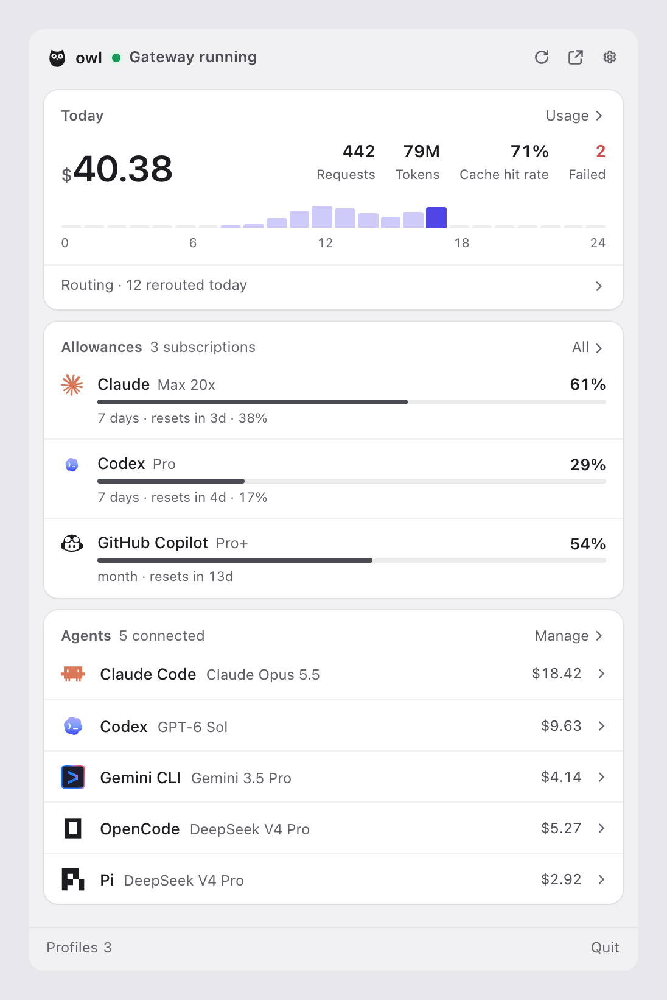
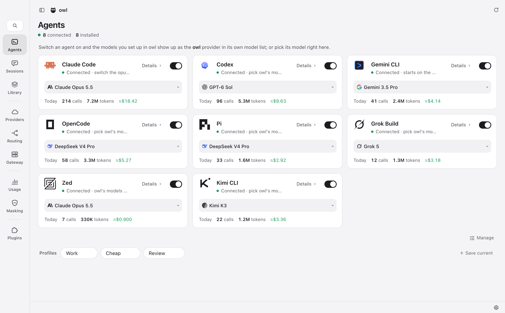
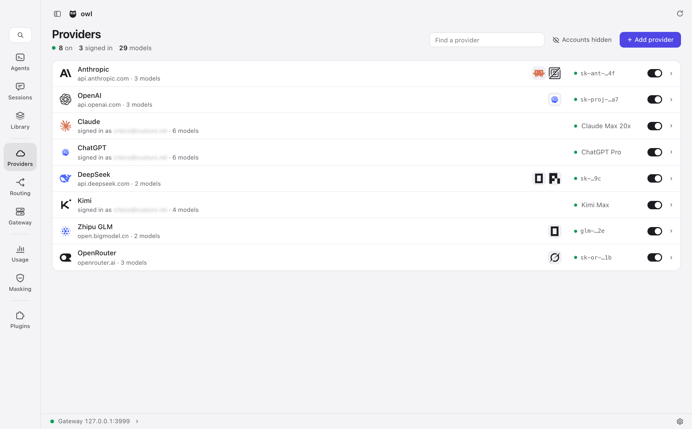
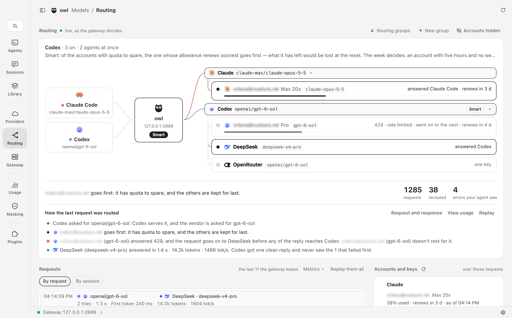
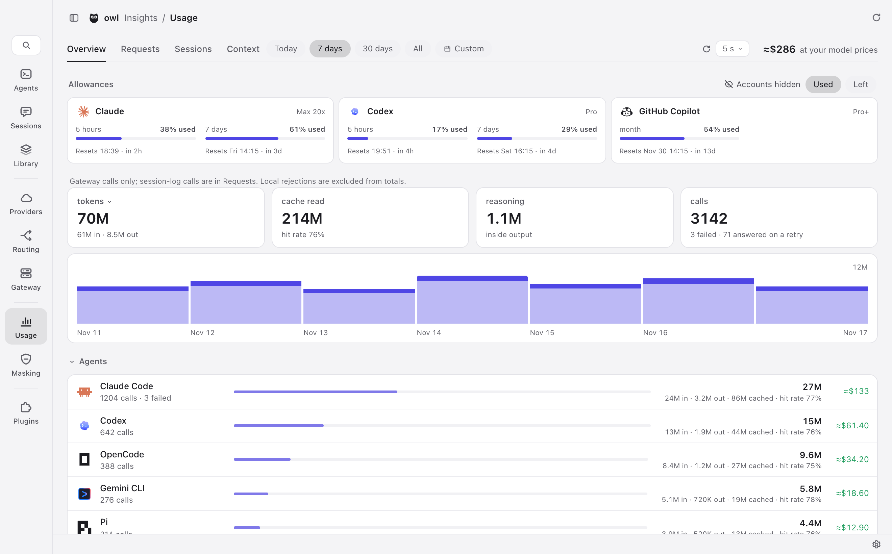
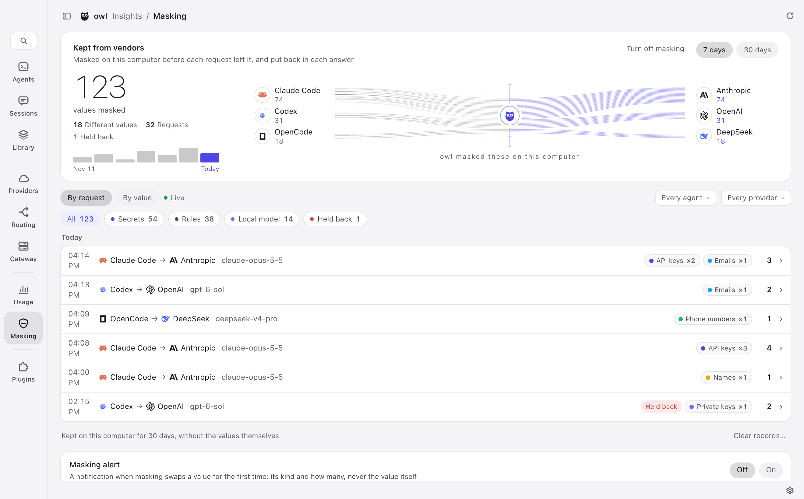

<div align="center">

<a href="https://github.com/istoo/owl"></a>

# owl

### Keeps an eye on your coding agents.

One menu bar icon for every coding agent you run: which model each one is on,<br>
what it spent today, and how much of each plan is left.<br>
Underneath it, one local gateway that every request passes through.

[](https://github.com/istoo/owl/releases/latest) [](https://github.com/istoo/owl/stargazers) [](LICENSE)<br>
    

**[Download](https://github.com/istoo/owl/releases/latest)** &nbsp;·&nbsp; **[Docs](https://github.com/istoo/owl/blob/main/site/public/docs/start.html)** &nbsp;·&nbsp; **[Reference](docs/reference.md)** &nbsp;·&nbsp; **[Plugins](https://github.com/magpie-community/plugins)** &nbsp;·&nbsp; [简体中文](README.zh-CN.md)

</div>

<br>

<picture>
  <source media="(prefers-color-scheme: dark)" srcset="site/public/img/readme/panel-en-dark.png">
  
</picture>

## Today, from the menu bar

Click the owl in the menu bar and the day is on one panel:

- **What it cost.** Today's spend, requests, tokens, cache hit rate and
  failures, with a bar for each hour.
- **What routing did.** How many requests went to another account or model
  because the first one couldn't answer.
- **What's left.** Each subscription's allowance, the window it counts and
  when it resets. A full one turns amber.
- **Who's on what.** Every connected agent, the model it uses and what it
  spent. Click one to open its card and change the model.
- **Profiles.** Switch every agent to a saved set of models at once.

Every line opens the page behind it. The window (↗) has the rest.

<br clear="right">

## Install

Get the app from **[Releases](https://github.com/istoo/owl/releases/latest)**, or run:

```sh
curl -fsSL https://github.com/istoo/owl/releases/latest/download/install.sh | sh
```

<sub>With a desktop, the script installs the app. On a Linux box without WebKitGTK 4.1 it installs that first through your package manager (sudo will ask for your password); with no desktop, or no terminal to answer the prompt, it installs the terminal build and names the package you still need. Pass `--gui` or `--tui` to choose. Behind a firewall, add `--proxy` or `--mirror`. Files called `owl-cli-*` are terminal builds, not documents: `chmod +x` one and run it, or let the script put `owl` on your PATH. The desktop app is `owl-darwin-*.zip`. You can also `go install github.com/istoo/owl@latest` or use the [Docker image](https://github.com/istoo/owl/blob/main/site/public/docs/docker.html). Every build updates itself, with release notes from this repository. To remove it, run the same command with `sh -s -- --uninstall`; settings in `~/.config/owl` survive unless you add `--purge`, which also disconnects and deletes your agents.</sub>

**First open on macOS.** The app is signed with owl's own certificate, not an
Apple Developer ID, and is not notarised. A copy downloaded by a browser
carries the quarantine flag, and macOS refuses it until you choose **Open
Anyway** in **System Settings → Privacy & Security**, or run
`/usr/bin/xattr -dr com.apple.quarantine /Applications/owl.app`. A copy
installed by the script comes through `curl` without that flag and opens
straight away.

**Is it for you?** owl helps once there is more than one of something: agents,
providers, or accounts on one provider. One agent on its vendor's own plan
needs nothing more than that agent's settings.

## The window

Five pages, in the order you'll use them the first day.

### Agents: one model list for all of them

<picture>
  <source media="(prefers-color-scheme: dark)" srcset="site/public/img/readme/window-agents-en-dark.png">
  
</picture>

Turn an agent on and every model owl knows appears in that agent's own model
picker. Or choose one here. owl changes only the setting that picks the
model and leaves the rest of the file, comments and formatting included, as
it was. Each card shows today's calls, tokens and cost. **Profiles** save the
whole page under a name (Work, Cheap, Review) to switch back to later.

The page also shows each CLI's version, updates it the way it was installed,
and gives the install command for the ones you don't have.

### Providers: keys, subscriptions, plugins

<picture>
  <source media="(prefers-color-scheme: dark)" srcset="site/public/img/readme/window-providers-en-dark.png">
  
</picture>

- **A key.** Choose a preset and paste it. The vendor gives the model list,
  and [models.dev](https://models.dev) fills in names and reasoning levels,
  so a model released this morning is in your picker after the next refresh.
  Any OpenAI- or Anthropic-compatible URL works too.
- **A subscription.** An agent you're already signed in to shows up with its
  models, and every other agent can use them. Claude drives the real local
  `claude` binary and bridges your agent's tools over MCP; ChatGPT, GitHub
  Copilot, Gemini Code Assist and SuperGrok work the same way.
  Add more accounts and owl moves between them. Antigravity runs through
  your own agy CLI (the Antigravity (local agy CLI) plugin): Google
  suspends accounts it sees on Code Assist through Antigravity's own
  client, which owl's built-in route and its old plugin both were.
- **A plugin.** Any OpenCode auth plugin or pi package from npm signs in,
  lists models and makes requests in owl (see [Plugins](#plugins)).

**Import** brings providers over from CC Switch, Claude Code, Codex and Alma.
An **[Add to owl](https://github.com/istoo/owl/blob/main/site/public/docs/import.html)**
link lets a provider's website hand its config to owl in one click. A key or
an account can have a proxy of its own. **Daily warm-up** opens each Claude
and ChatGPT account's 5-hour window at the times you pick.

<details>
<summary><b>Presets</b></summary>

<br>

Anthropic · OpenAI · Google Gemini · Google Vertex AI · Amazon Bedrock (runtime and Mantle) · DeepSeek · Kimi · Zhipu GLM · MiniMax · StepFun · LongCat · Qwen · Baidu Qianfan · Tencent Cloud · Huawei Cloud MaaS · Volcengine Ark · Mistral · Groq · Nous Portal · xAI · OpenRouter · Together · Fireworks · SiliconFlow · NVIDIA NIM · ModelScope · Ollama · LM Studio

</details>

### Routing: where each request went, and why

<picture>
  <source media="(prefers-color-scheme: dark)" srcset="site/public/img/readme/window-routing-en-dark.png">
  
</picture>

The page draws each request as it happens: which agent sent it, the account
it reached, and when an account refused, where it went next. Below the
drawing, the latest request's route is told in plain words.

A **routing group** puts several models under one name an agent can choose,
like `group/daily-coding`, and spreads requests over every member's keys and
accounts:

| Mode | Picks |
| :-- | :-- |
| **`smart`** | the subscription with quota left that resets soonest, so less goes to waste |
| **`order`** | the first model, then the next when it can't answer |
| **`rotate`** | the next member each turn |
| **`usage`** | the member used least |
| **`pace`** | the account with the most weekly quota left per hour until reset |

A conversation stays on the account that answered it while the vendor's
prompt cache is worth keeping. Groups can hold groups.
**[Intent routing](https://github.com/istoo/owl/blob/main/site/public/docs/intent.html)**
has a small model read each new turn and sends hard work to the strong model
and quick questions to the cheap one.

### Usage: tokens, cost and quota

<picture>
  <source media="(prefers-color-scheme: dark)" srcset="site/public/img/readme/window-usage-en-dark.png">
  
</picture>

Tokens, cache reads and writes, reasoning and calls, priced at list price in
dollars or yuan; any model can have your own price. Quota windows and balances
for every key, plan and account, with a reminder when a window is about to
reset with much of it unused. **Sessions** lists every conversation with its
title and cost and reopens it in your terminal. **Context** shows how full
each request's window was and what filled it. Bills split by account and
upstream key, and export over OTLP.

### Masking: secrets stay on your computer

<picture>
  <source media="(prefers-color-scheme: dark)" srcset="site/public/img/readme/window-masking-en-dark.png">
  
</picture>

An agent that reads an `.env`, a config file or a log puts what it read into
the prompt. With masking on, owl swaps the secrets for placeholders like
`{{API_KEY_k3v9x2mq}}` before the request leaves, and swaps them back in the
reply, streamed text and tool-call arguments included. Your agent and your
files keep the real values; the vendor never sees them.

- **Found by rule or by model.** Keys, private keys, tokens, emails, and card
  or ID numbers whose checksum adds up are caught by rule. Names, addresses
  and passwords can go to an optional model that runs on this computer
  (a 1.6 GB download, CPU).
- **The same value, the same placeholder,** every turn, so the conversation,
  the prompt cache and thinking signatures stay valid.
- **Memory only.** The record keeps a value's kind, length and first
  characters. If masking is on but can't run, the request is held back with
  a 503 rather than sent as written.
- **Your call per kind.** Mask, warn or block each kind (passport, IBAN, MAC,
  public IP…), add your own words and patterns, and see a request beside what
  the vendor got.

The cost: the model sees the placeholder, so a task about the value itself
("why is this token refused?") can't be done on it. Put such values under
**Never mask**. Masking is off until you turn it on in **Settings → Privacy**.
Emails at example domains (`example.com`, `.test`, `.invalid`) pass through.

## The terminal

Everything the window does has a command, and `owl tui` puts the whole app in
a terminal.

```sh
owl provider add deepseek sk-…              # a preset needs only the key
owl claude deepseek/deepseek-v4-pro          # Claude Code on DeepSeek
owl codex moonshot/kimi-k2.5                 # Codex on Kimi
owl group add "Opus anywhere" models=claude/claude-opus-5-5,copilot/claude-opus-5.5 routing=smart
owl claude group/opus-anywhere               # fails over between subscriptions
owl save work && owl use work                # profiles
owl quota                                    # what's left on every plan
owl settings set theme dark                  # any Settings switch
owl tui
```

owl finds the subscriptions your agents already signed in to by reading their
sign-ins (Claude Code's and Codex's files, the Keychain). Turn that off under
**Settings → Privacy → Subscription accounts** or with
`owl accounts discovery off`; `OWL_NO_ACCOUNTS=1` skips it for one run.
API-key providers work either way.

## Anything with a base URL

One gateway listens on `127.0.0.1:3425`. It speaks OpenAI Chat, OpenAI
Responses, Anthropic Messages and Gemini, and translates between them,
streaming, tool calls and reasoning included. Routing, plugins and masking
sit on that one path, so they apply to every agent and to anything else you
point at it:

```sh
export OPENAI_BASE_URL=http://127.0.0.1:3425/v1     OPENAI_API_KEY=owl
export ANTHROPIC_BASE_URL=http://127.0.0.1:3425     ANTHROPIC_API_KEY=owl
export GOOGLE_GEMINI_BASE_URL=http://127.0.0.1:3425 GEMINI_API_KEY=owl
```

## Plugins

```sh
owl plugin add opencode-gemini-auth   # an OpenCode plugin from npm
owl plugin add @magpie-community/opencode-agy-cli-auth  # Antigravity through your own agy CLI
owl plugin login google-plugin        # its own sign-in, inside owl
```

Plugins run on [Bun](https://bun.sh), downloaded the first time one is needed.
Browse **[magpie-community/plugins](https://github.com/magpie-community/plugins)**
or [write your own](https://github.com/istoo/owl/blob/main/site/public/docs/plugins.html).

A plugin can also be **gateway middleware**: JavaScript that sees what every
agent sends and gets back. `onRequest` can rewrite or refuse a request,
`onEvent` sees each streamed event, `onResponse` the finished reply. A hook
that throws or runs too long is skipped and the request goes through as it was.

```js
// alias.middleware.js — owl plugin add ./alias.middleware.js
export function onRequest(body, ctx) {
  if (body.model === "fast") return { ...body, model: "deepseek/deepseek-chat" };
}
```

<details>
<summary><b>Ready-made middleware</b>, mostly what <a href="https://github.com/QuantumNous/new-api">New API</a> does for its channels, with the same JSON</summary>

<br>

| Package | Does |
| :-- | :-- |
| `param-override` | New API's `param_override`: set, delete, move or rewrite request fields under conditions, or refuse a request |
| `model-map` | New API's `model_mapping`: send a model under another name; the reply keeps the name asked for |
| `system-prompt` | Add your system prompt to every request, or to some agents or models |
| `word-guard` | New API's sensitive-word filter: refuse or mask words in requests and replies |
| `think-tags` | Take ` thinking…` out of replies, or add `reasoning_content` to them |

```sh
owl plugin add @magpie-community/middleware-model-map
owl plugin options model-map '{"mapping": {"fast": "deepseek/deepseek-chat"}}'
```

They're under Plugins › Discover › Gateway middleware. See [Gateway middleware](https://github.com/istoo/owl/blob/main/site/public/docs/plugins.html#middleware).

</details>

## Also in owl

| | |
| :-- | :-- |
| **Library** | Instructions, MCP servers, skills and subagents, written once and placed in each agent's files in its own format; owl removes only what it placed |
| **Web search for any model** | A provider that can search, or search APIs (Tavily, Brave, Exa, Firecrawl, You.com, DeepSeek, Doubao Search, Yuanbao Search, SearXNG) in your order; also an MCP server with `web_search` and `web_fetch` |
| **Images and video** | An image tool over MCP for any agent, on the model you choose; video through a Grok subscription or a MiniMax key |
| **Local network** | *Share on local network*, with a named gateway key per client and its own daily, weekly or monthly token and cost limit |
| **[Remote owl](https://github.com/istoo/owl/blob/main/site/public/docs/remote.html)** | A laptop uses the providers, accounts and groups of the owl on your desktop and still wires its own agents |
| **[Docker](https://github.com/istoo/owl/blob/main/site/public/docs/docker.html)** | `ghcr.io/istoo/owl` on a server or NAS, managed from the web UI |
| **Sync** | A backup file, or sync over WebDAV (Nutstore, Nextcloud…), S3, or an encrypted GitHub repository |
| **And** | WSL, keep awake, light and dark themes, and your theme's look on [Omarchy](https://omarchy.org) |

<details>
<summary><b>Supported agents</b>: owl lists the ones installed on your machine</summary>

<br>

Claude Code · Claude Desktop · Claude Science · Codex · Gemini CLI · Antigravity CLI · OpenCode · OpenChamber · MiMo Code · DevEco Code · Pi · oh-my-pi · StepCode · MothX · PenguinHarness · Aside · OmO · Prime Agent · Goose · Cursor CLI · Cursor Private Inference · Zed · VS Code Chat · VS Code Insiders · VSCodium Chat · Zoo Code · JetBrains Air · Air (JetBrains IDEs) · Copilot (JetBrains) · Copilot CLI · Crush · DeepSeek Harness · Reasonix Studio · Command Code · fx · Devin · Hermes Agent · Mister Morph · Kimi Code · jcode · Qwen Code · Muse Code · Empryo · MiniMax Code · Droid · Cline · Qoder · Qoder CN · Grok Build · Grok App · ZCode · WorkBuddy · WorkBuddy AI · CodeBuddy · Pencil · OpenPencil · OpenBot · NewMax · Raycast · Kiro Crew · T3 Code · OpenHanako · AtomCode · Snow CLI · Alma · Cindy · Lody · AionUi · Ante · AstrBot · QwenPaw · OpenClaw

Notes on setting up some of them are in the [reference](docs/reference.md#notes-on-some-agents).

</details>

## Docs

**[Get started](https://github.com/istoo/owl/blob/main/site/public/docs/start.html)** ·
**[Reference](docs/reference.md)** (every agent, provider option, endpoint, command and file) ·
**[Plugins](https://github.com/istoo/owl/blob/main/site/public/docs/plugins.html)** ·
**[Intent routing](https://github.com/istoo/owl/blob/main/site/public/docs/intent.html)** ·
**[Import links](https://github.com/istoo/owl/blob/main/site/public/docs/import.html)** ·
**[Remote owl](https://github.com/istoo/owl/blob/main/site/public/docs/remote.html)** ·
**[Docker](https://github.com/istoo/owl/blob/main/site/public/docs/docker.html)**

## Privacy

Prompts, replies, keys and accounts go only to the providers you chose, and
with [masking](#masking-secrets-stay-on-your-computer) on, the secrets in them
don't go even there. This build sends nothing anywhere else: no usage events,
no partner list, no icon proxy. Updates, release notes and images come only
from this GitHub repository.

## Feedback

Questions, ideas, a model that won't show up: **[open an issue](https://github.com/istoo/owl/issues)**.

**This repository doesn't take pull requests**; only maintainers open them.
Describe the fix or feature in an issue and it gets built.

If owl spared you one more config file, **a ⭐ helps others find it.**

<a href="https://star-history.com/#istoo/owl&Date">
  <picture>
    <source media="(prefers-color-scheme: dark)" srcset="https://api.star-history.com/svg?repos=istoo/owl&type=Date&theme=dark">
    
  </picture>
</a>
