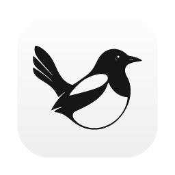
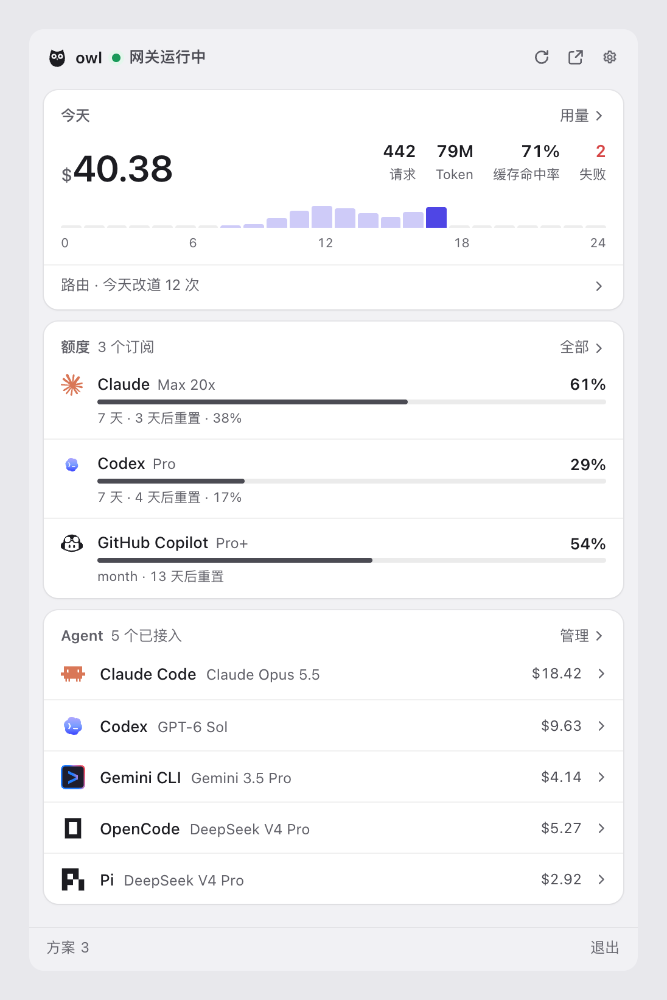
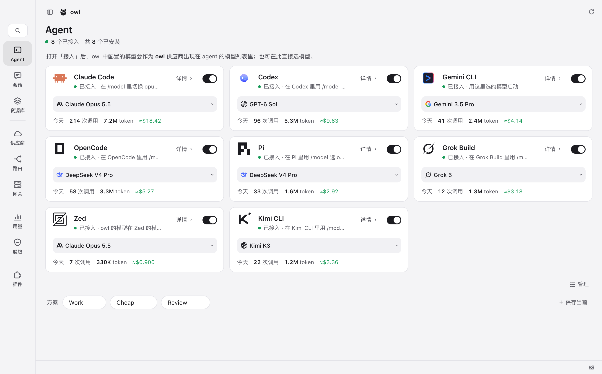
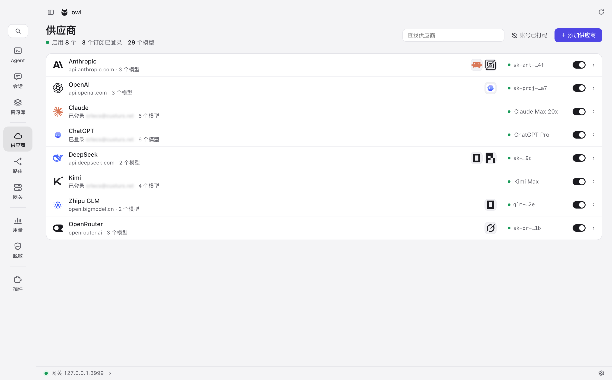
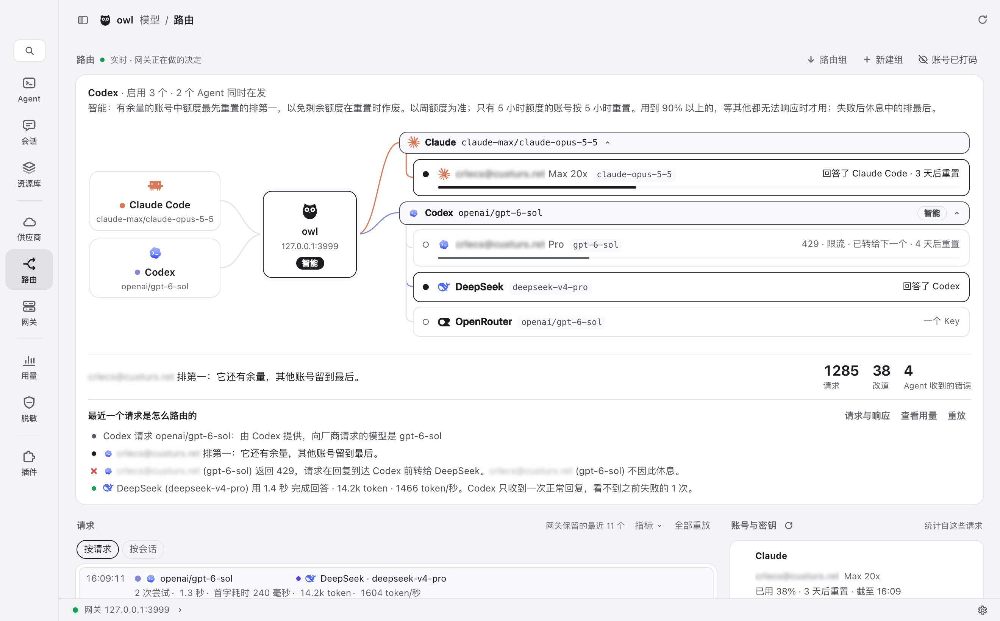
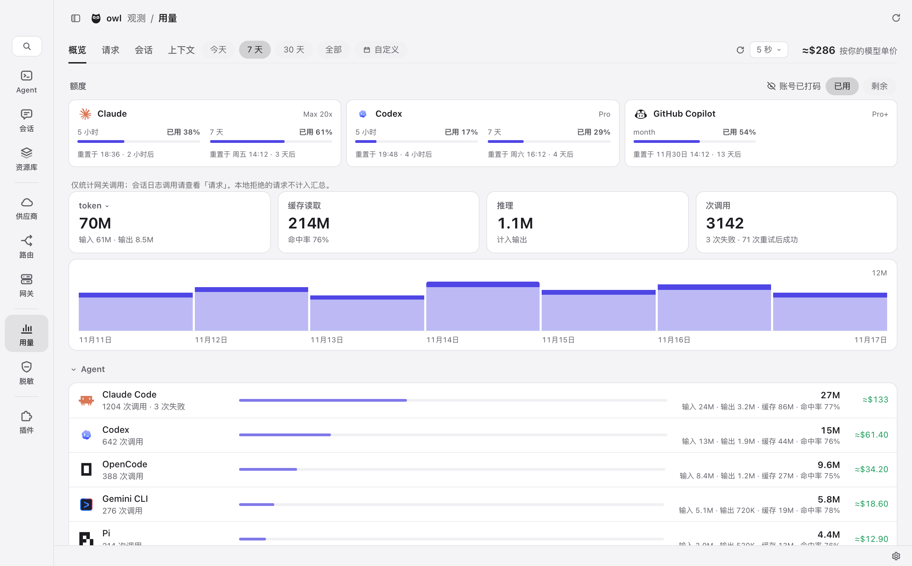
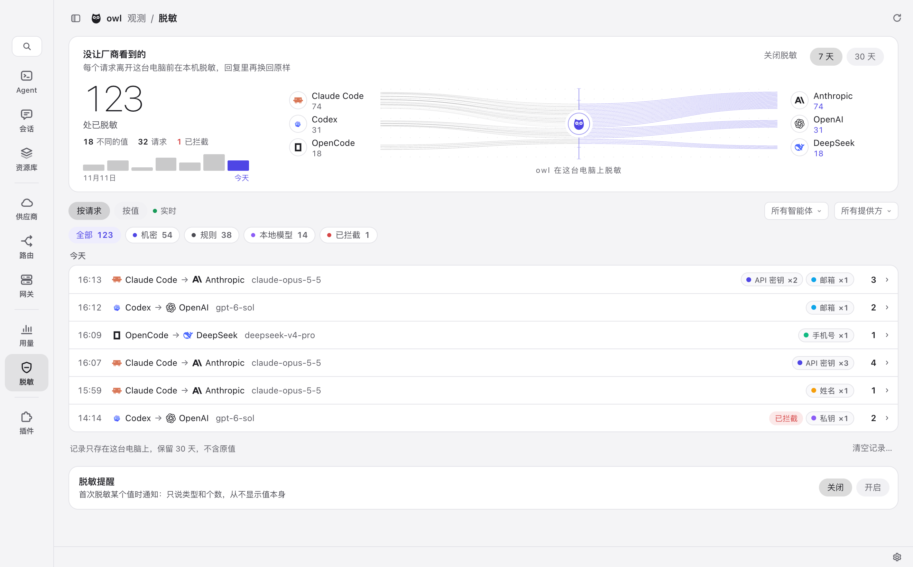

<div align="center">

<a href="https://github.com/istoo/owl"></a>

# owl

### 替你盯着每一个 coding agent。

菜单栏里一个图标，管住你在跑的所有 coding agent：每个用的是什么模型，<br>
今天花了多少，每个套餐还剩多少。<br>
它底下是一个本地网关，每个请求都从这里经过。

[](https://github.com/istoo/owl/releases/latest) [](https://github.com/istoo/owl/stargazers) [](LICENSE)<br>
    

**[下载](https://github.com/istoo/owl/releases/latest)** &nbsp;·&nbsp; **[中文使用手册](docs/user-guide.zh-CN.md)** &nbsp;·&nbsp; **[快速上手](https://github.com/istoo/owl/blob/main/site/public/docs/zh/start.html)** &nbsp;·&nbsp; **[完整参考（英文）](docs/reference.md)** &nbsp;·&nbsp; **[插件](https://github.com/magpie-community/plugins)** &nbsp;·&nbsp; [English](README.md)

</div>

<br>

<picture>
  <source media="(prefers-color-scheme: dark)" srcset="site/public/img/readme/panel-zh-dark.png">
  
</picture>

## 今天，在菜单栏里看

点一下菜单栏里的猫头鹰，今天的情况都在一个面板上：

- **花了多少。** 今天的花费、请求数、token、缓存命中率和失败数，按小时一根柱子。
- **路由做了什么。** 有多少请求因为第一个账号答不了，被换到别的账号或模型。
- **还剩多少。** 每个订阅的额度、按什么窗口算、什么时候重置。用满的那条变成琥珀色。
- **谁在用什么。** 每个已接入的 agent、它用的模型和花费。点一下打开它的卡片换模型。
- **方案。** 一次把所有 agent 切到一套存好的模型。

每一行都能点开背后的页面，其余的都在窗口里（↗）。

<br clear="right">

## 安装

从 **[Releases](https://github.com/istoo/owl/releases/latest)** 下载应用，或者：

```sh
curl -fsSL https://github.com/istoo/owl/releases/latest/download/install.sh | sh
```

<sub>有桌面时，脚本装的是应用。Linux 上没有 WebKitGTK 4.1 时，脚本会先用你的包管理器装上（sudo 会问密码）；没有桌面、或者没有终端可以应答，它就装终端版，并告诉你还缺哪个包。想指定装哪个，加 `--gui` 或 `--tui`。在防火墙后面，加 `--proxy` 或 `--mirror`。叫 `owl-cli-*` 的文件是终端版，不是文档：`chmod +x` 之后直接运行，或者让脚本把 `owl` 放进 PATH。桌面应用是 `owl-darwin-*.zip`。也可以 `go install github.com/istoo/owl@latest`，或者用 [Docker 镜像](https://github.com/istoo/owl/blob/main/site/public/docs/zh/docker.html)。每个构建都会自更新，更新说明来自这个仓库。卸载就用同一条命令加 `sh -s -- --uninstall`；`~/.config/owl` 里的设置会留下，除非再加 `--purge`，那会连你的 agent 一起断开并删除。</sub>

**macOS 第一次打开。** 应用用 owl 自己的证书签名（不是 Apple Developer ID），没有公证。浏览器下载的副本带 quarantine 标记，macOS 会拒绝运行，直到你在 **系统设置 → 隐私与安全性** 里点 **仍要打开**，或者执行 `/usr/bin/xattr -dr com.apple.quarantine /Applications/owl.app`。用上面的脚本装的副本走 `curl`，没有这个标记，直接就能打开。

**适合你吗？** 只要有一样东西不止一个，owl 就有用：多个 agent、多个供应商，或者同一个供应商的多个账号。只有一个 agent、用的又是它自家的套餐，那 agent 自己的设置就够了。

## 窗口

五个页面，按第一天用到的顺序排。

### Agent：所有 agent 共用一份模型清单

<picture>
  <source media="(prefers-color-scheme: dark)" srcset="site/public/img/readme/window-agents-zh-dark.png">
  
</picture>

打开一个 agent 的「接入」，owl 知道的所有模型就出现在这个 agent 自己的模型选择里；也可以直接在这里选。owl 只改决定模型的那一项设置，文件其余部分连注释和排版都不动。每张卡片显示今天的调用数、token 和花费。**方案** 把整页存成一个名字（Work、Cheap、Review），以后一键切回来。

这个页面还显示每个 CLI 的版本，按它当初的安装方式更新，没装的给出安装命令。

### 供应商：key、订阅、插件

<picture>
  <source media="(prefers-color-scheme: dark)" srcset="site/public/img/readme/window-providers-zh-dark.png">
  
</picture>

- **一个 key。** 选预设，粘贴进去。模型清单由供应商提供，名称和推理档位从 [models.dev](https://models.dev) 补全，今早发布的模型，下次刷新就在选择器里。任何 OpenAI 或 Anthropic 兼容的 URL 也行。
- **一个订阅。** 你已经登录的 agent 会带着它的模型出现，其他每个 agent 都能用。Claude 驱动本机真实的 `claude` 二进制，并通过 MCP 桥接你 agent 的工具；ChatGPT、GitHub Copilot、Gemini Code Assist、SuperGrok 也一样。多加几个账号，owl 就在它们之间切换。Antigravity 通过你自己的 agy CLI 使用（Antigravity (local agy CLI) 插件）：Google 会封禁经 Antigravity 自家客户端访问 Code Assist 的账号，owl 的内置直连和旧插件都曾这样做。
- **一个插件。** npm 上的任何 OpenCode 认证插件或 pi 包，都能在 owl 里登录、列模型、发请求（见[插件](#插件)）。

**导入** 能把 CC Switch、Claude Code、Codex 和 Alma 里的供应商搬过来。**[Add to owl](https://github.com/istoo/owl/blob/main/site/public/docs/zh/import.html)** 链接让供应商官网一键把配置交给 owl。每个 key、每个账号都可以单独走代理。**每日预热** 在你选的时间开启每个 Claude 和 ChatGPT 账号的 5 小时窗口。

<details>
<summary><b>预设</b></summary>

<br>

Anthropic · OpenAI · Google Gemini · Google Vertex AI · Amazon Bedrock（runtime 和 Mantle）· DeepSeek · Kimi · 智谱 GLM · MiniMax · StepFun · LongCat · 通义千问 · 百度千帆 · 腾讯云 · 华为云 MaaS · 火山方舟 · Mistral · Groq · Nous Portal · xAI · OpenRouter · Together · Fireworks · SiliconFlow · NVIDIA NIM · ModelScope · Ollama · LM Studio

</details>

### 路由：每个请求去了哪里、为什么

<picture>
  <source media="(prefers-color-scheme: dark)" srcset="site/public/img/readme/window-routing-zh-dark.png">
  
</picture>

页面实时画出每个请求：哪个 agent 发的，到了哪个账号，账号拒绝时又去了哪里。图下面用大白话讲清最近一个请求是怎么走的。

**路由组** 把几个模型放在一个名字下，agent 把它当一个来选，比如 `group/daily-coding`，请求分摊到每个成员的 key 和账号上：

| 模式 | 挑谁 |
| :-- | :-- |
| **`smart`** | 还有额度的订阅里最快重置的那个，浪费最少 |
| **`order`** | 先用第一个模型，答不了再换下一个 |
| **`rotate`** | 每回合换下一个成员 |
| **`usage`** | 用得最少的成员 |
| **`pace`** | 到重置前每小时剩余周额度最多的账号 |

只要供应商的提示词缓存还值得保留，一段对话就留在回答它的账号上。组里可以套组。**[意图路由](https://github.com/istoo/owl/blob/main/site/public/docs/zh/intent.html)** 让一个小模型读每个新回合，重活交给强模型，随口的问题交给便宜的。

### 用量：token、花费和额度

<picture>
  <source media="(prefers-color-scheme: dark)" srcset="site/public/img/readme/window-usage-zh-dark.png">
  
</picture>

Token、缓存读写、推理和调用次数，按牌价折成人民币或美元；每个模型都能设自己的价格。每个 key、套餐和账号的额度窗口与余额，窗口快重置却还剩很多时会提醒。**会话** 列出每段对话的标题和花费，点一下回到你的终端。**上下文** 显示每个请求的窗口有多满、被什么占着。账单可以按账号、按上游 key 拆开，也能用 OTLP 导出。

### 脱敏：秘密留在你的电脑上

<picture>
  <source media="(prefers-color-scheme: dark)" srcset="site/public/img/readme/window-masking-zh-dark.png">
  
</picture>

agent 读了 `.env`、配置文件或带 token 的日志，读到的东西就进了提示词。打开脱敏后，owl 在请求离开本机之前把秘密换成 `{{API_KEY_k3v9x2mq}}` 这样的占位符，再在回复里换回来，流式文本和工具调用参数也不例外。你的 agent 和文件拿到的仍是真值，供应商看不到。

- **规则抓，或者模型认。** key、私钥、token、邮箱，以及校验和成立的卡号和证件号由规则抓。姓名、地址和密码可以交给一个在这台电脑上跑的可选模型（1.6 GB 下载，用 CPU）。
- **同一个值，同一个占位符**，每个回合都一样，对话、提示词缓存和 thinking 签名因此保持有效。
- **只在内存。** 记录里只有值的种类、长度和前几个字符。脱敏开着却跑不起来时，请求会被拦下并返回 503，不会按原样发出去。
- **每种都由你定。** 每个种类（护照、IBAN、MAC、公网 IP……）可以脱敏、只警告或拦截，可以加自己的词和模式，还能把一个请求和供应商实际收到的内容并排看。

代价是：模型看到的是占位符，所以针对这个值本身的任务（「这个 token 为什么被拒？」）做不了。这类值放进 **从不脱敏**。脱敏默认关闭，在 **设置 → 隐私** 里打开。示例专用域名（`example.com`、`.test`、`.invalid`）下的邮箱原样通过。

## 终端

窗口里能做的事都有对应的命令，`owl tui` 把整个应用搬进终端。

```sh
owl provider add deepseek sk-…              # 预设只要 key
owl claude deepseek/deepseek-v4-pro          # Claude Code 用 DeepSeek
owl codex moonshot/kimi-k2.5                 # Codex 用 Kimi
owl group add "Opus anywhere" models=claude/claude-opus-5-5,copilot/claude-opus-5.5 routing=smart
owl claude group/opus-anywhere               # 在订阅之间故障切换
owl save work && owl use work                # 方案
owl quota                                    # 每个套餐还剩多少
owl settings set theme dark                  # 任何一项设置
owl tui
```

owl 读取 agent 的登录记录（Claude Code 和 Codex 的文件、钥匙串），发现你已经登录的订阅。不想让它读，关掉 **设置 → 隐私 → 订阅账号**，或运行 `owl accounts discovery off`；`OWL_NO_ACCOUNTS=1` 只跳过这一次运行。API key 供应商两种情况下都照常可用。

## 任何能填 base URL 的程序

网关监听 `127.0.0.1:3425`，接收 OpenAI Chat、OpenAI Responses、Anthropic Messages 和 Gemini 请求，并在它们之间翻译，流式、工具调用和推理都在其中。路由、插件和脱敏都在这一条路上，所以对每个 agent 都生效，对你指向它的其他程序也一样：

```sh
export OPENAI_BASE_URL=http://127.0.0.1:3425/v1     OPENAI_API_KEY=owl
export ANTHROPIC_BASE_URL=http://127.0.0.1:3425     ANTHROPIC_API_KEY=owl
export GOOGLE_GEMINI_BASE_URL=http://127.0.0.1:3425 GEMINI_API_KEY=owl
```

## 插件

```sh
owl plugin add opencode-gemini-auth   # npm 上的 OpenCode 插件
owl plugin add @magpie-community/opencode-agy-cli-auth  # 通过你自己的 agy CLI 使用 Antigravity
owl plugin login google-plugin        # 它自己的登录流程，在 owl 里完成
```

插件跑在 [Bun](https://bun.sh) 上，第一次用到时自动下载。到 **[magpie-community/plugins](https://github.com/magpie-community/plugins)** 找，或者[自己写一个](https://github.com/istoo/owl/blob/main/site/public/docs/zh/plugins.html)。

插件也能当**网关中间件**：一段看得见每个 agent 发出和收回什么的 JavaScript。`onRequest` 可以改写或拒绝请求，`onEvent` 看每个流式事件，`onResponse` 看完整回复。hook 抛异常或跑太久就被跳过，请求原样通过。

```js
// alias.middleware.js — owl plugin add ./alias.middleware.js
export function onRequest(body, ctx) {
  if (body.model === "fast") return { ...body, model: "deepseek/deepseek-chat" };
}
```

<details>
<summary><b>现成的中间件</b>，大多是 <a href="https://github.com/QuantumNous/new-api">New API</a> 对渠道做的事，JSON 也一样</summary>

<br>

| 包 | 做什么 |
| :-- | :-- |
| `param-override` | New API 的 `param_override`：在条件下设置、删除、移动或改写请求字段，也可以拒绝请求 |
| `model-map` | New API 的 `model_mapping`：用另一个名字发模型，回复仍用请求时的名字 |
| `system-prompt` | 给每个请求加上你的系统提示词，或者只给某些 agent、某些模型 |
| `word-guard` | New API 的敏感词过滤：拦截或遮盖请求和回复里的词 |
| `think-tags` | 把 ` thinking…` 从回复里去掉，或者往回复里加 `reasoning_content` |

```sh
owl plugin add @magpie-community/middleware-model-map
owl plugin options model-map '{"mapping": {"fast": "deepseek/deepseek-chat"}}'
```

在 插件 › 发现 › 网关中间件 里能找到它们。见[网关中间件](https://github.com/istoo/owl/blob/main/site/public/docs/zh/plugins.html#middleware)。

</details>

## owl 里还有

| | |
| :-- | :-- |
| **资料库** | 指令、MCP 服务器、技能和子 agent 只写一次，按每个 agent 的格式放进它的文件；owl 只收回自己放进去的东西 |
| **任何模型都能联网搜索** | 用一个本身能搜的供应商，或按你排的顺序接搜索 API（Tavily、Brave、Exa、Firecrawl、You.com、DeepSeek、豆包搜索、元宝搜索、SearXNG）；也能作为 MCP 服务器挂给 agent，带 `web_search` 和 `web_fetch` |
| **图片和视频** | 任何 agent 都能通过 MCP 用图片工具，模型由你选；视频用 Grok 订阅或 MiniMax key |
| **局域网** | *局域网共享*，每个客户端一把命名网关 key，各自带每天、每周或每月的 token 与花费上限 |
| **[远程 owl](https://github.com/istoo/owl/blob/main/site/public/docs/zh/remote.html)** | 笔记本用台式机上那台 owl 的供应商、账号和路由组，同时仍配置自己的 agent |
| **[Docker](https://github.com/istoo/owl/blob/main/site/public/docs/zh/docker.html)** | 在服务器或 NAS 上跑 `ghcr.io/istoo/owl`，从 Web UI 管理 |
| **同步** | 备份成文件，或用 WebDAV（坚果云、Nextcloud……）、S3、加密的 GitHub 仓库在多台机器之间同步 |
| **还有** | WSL、保持唤醒、浅色与深色，以及你的主题在 [Omarchy](https://omarchy.org) 上的外观 |

<details>
<summary><b>支持的 agent</b>：owl 只列出你机器上装了的</summary>

<br>

Claude Code · Claude Desktop · Claude Science · Codex · Gemini CLI · Antigravity CLI · OpenCode · OpenChamber · MiMo Code · DevEco Code · Pi · oh-my-pi · StepCode · MothX · PenguinHarness · Aside · OmO · Prime Agent · Goose · Cursor CLI · Cursor Private Inference · Zed · VS Code Chat · VS Code Insiders · VSCodium Chat · Zoo Code · JetBrains Air · Air（JetBrains IDE）· Copilot（JetBrains）· Copilot CLI · Crush · DeepSeek Harness · Reasonix Studio · Command Code · fx · Devin · Hermes Agent · Mister Morph · Kimi Code · jcode · Qwen Code · Muse Code · Empryo · MiniMax Code · Droid · Cline · Qoder · Qoder CN · Grok Build · Grok App · ZCode · WorkBuddy · WorkBuddy AI · CodeBuddy · Pencil · OpenPencil · OpenBot · NewMax · Raycast · Kiro Crew · T3 Code · OpenHanako · AtomCode · Snow CLI · Alma · Cindy · Lody · AionUi · Ante · AstrBot · QwenPaw · OpenClaw

其中一些的配置说明在[参考](docs/reference.md#notes-on-some-agents)里。

</details>

## 文档

**[入门](https://github.com/istoo/owl/blob/main/site/public/docs/zh/start.html)** ·
**[完整参考（英文）](docs/reference.md)**（每个 agent、供应商选项、网关端点、命令和文件） ·
**[插件](https://github.com/istoo/owl/blob/main/site/public/docs/zh/plugins.html)** ·
**[意图路由](https://github.com/istoo/owl/blob/main/site/public/docs/zh/intent.html)** ·
**[导入链接](https://github.com/istoo/owl/blob/main/site/public/docs/zh/import.html)** ·
**[远程 owl](https://github.com/istoo/owl/blob/main/site/public/docs/zh/remote.html)** ·
**[Docker](https://github.com/istoo/owl/blob/main/site/public/docs/zh/docker.html)**

## 隐私

提示词、回复、key 和账号只会去你选的供应商；打开[脱敏](#脱敏秘密留在你的电脑上)后，其中的秘密连供应商也去不了。这个构建不向别处发送任何东西：没有使用事件，没有合作方名单，没有图标代理。更新、更新说明和图片只来自这个 GitHub 仓库。

## 反馈

有问题、有想法，或者某个模型就是不出现？**[开一个 issue](https://github.com/istoo/owl/issues)**。

**这个仓库不接受 pull request**，只有维护者能开。想要某个修复或功能，在 issue 里说清楚，我们来做。

如果 owl 让你少改了一个配置文件，**一个 ⭐ 能让更多人找到它。**

<a href="https://star-history.com/#istoo/owl&Date">
  <picture>
    <source media="(prefers-color-scheme: dark)" srcset="https://api.star-history.com/svg?repos=istoo/owl&type=Date&theme=dark">
    
  </picture>
</a>
