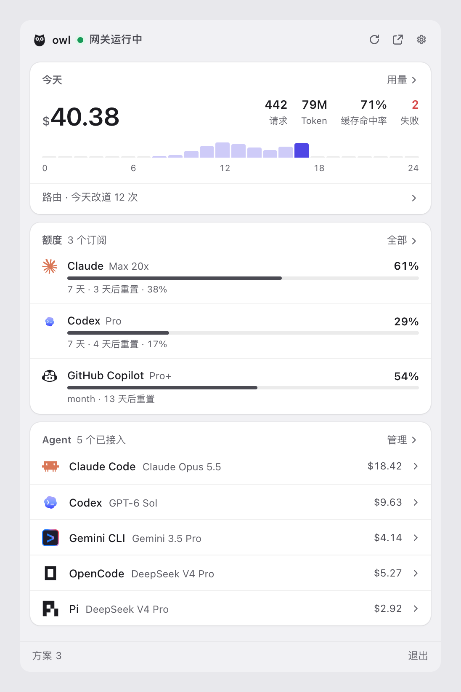
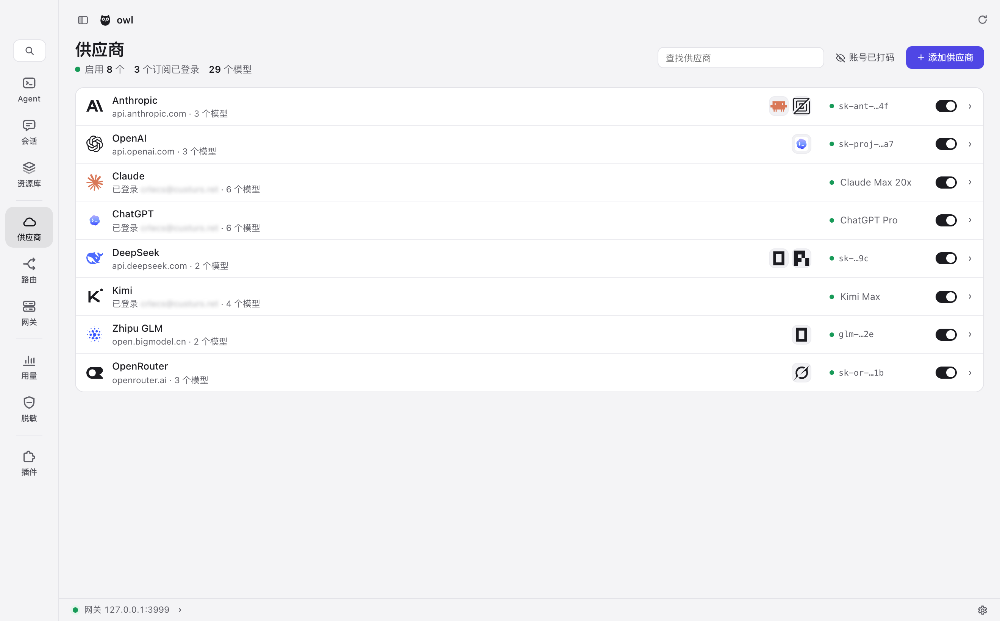
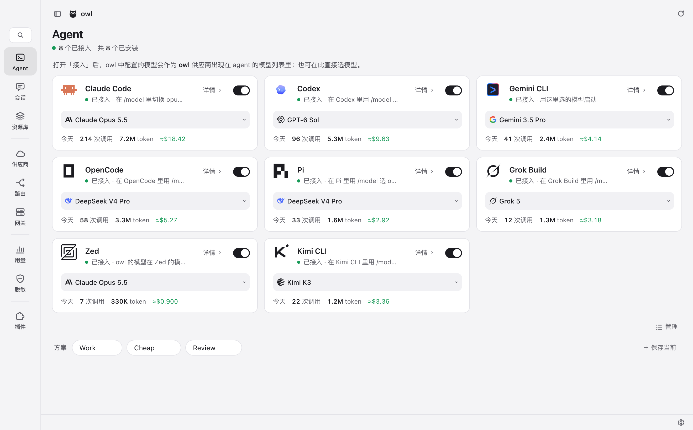
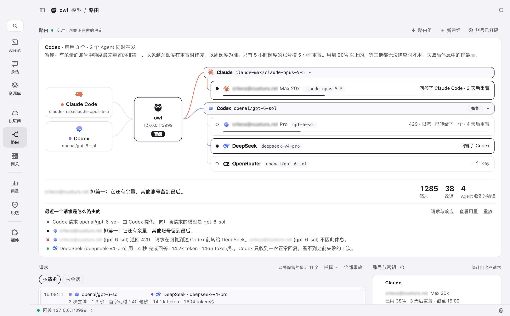
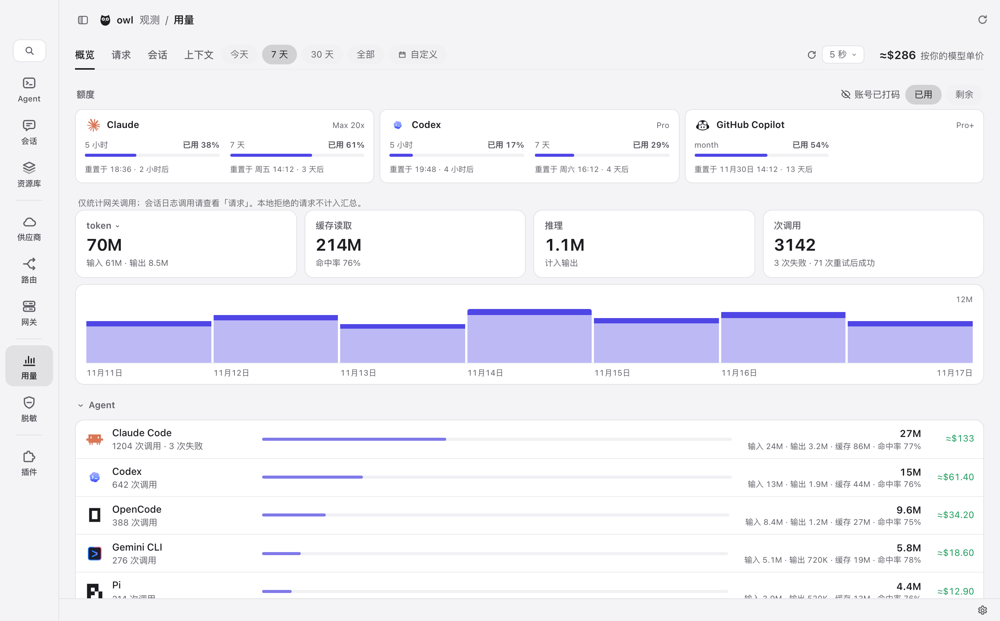
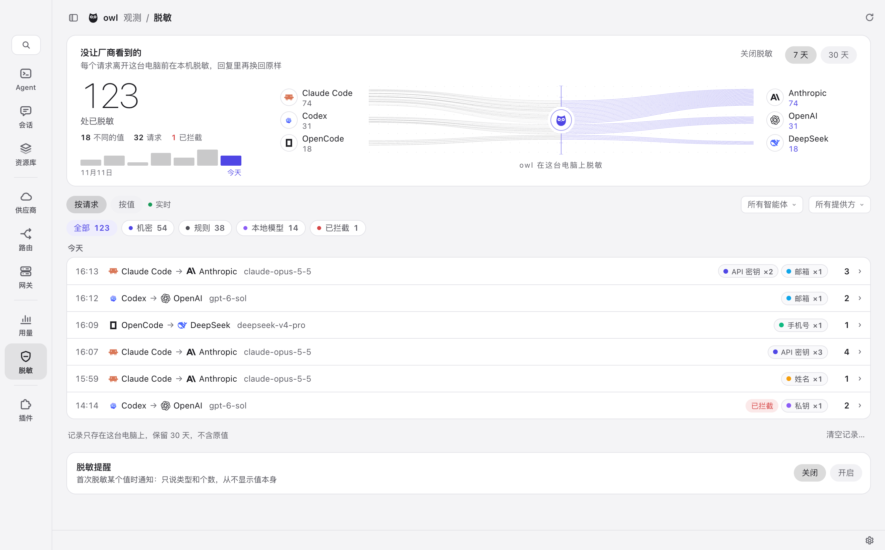

# Owl 中文使用手册

适用于 **Owl v0.2.27**。菜单名称以简体中文桌面窗口为准；窄窗口的入口可能收进「更多」，关闭对应内置插件也会隐藏页面。本文写的是这个版本已发布的功能，不把开发分支上的界面算进去。截图是示例数据，不代表你的账单或额度。

## 目录

- [1. 安装与第一次接入](#1-安装与第一次接入)
- [2. 菜单栏和托盘面板](#2-菜单栏和托盘面板)
- [3. 供应商、账号和模型](#3-供应商账号和模型)
- [4. Agent、模型可见性和方案](#4-agent模型可见性和方案)
- [5. 路由和故障切换](#5-路由和故障切换)
- [6. 用量、额度和会话](#6-用量额度和会话)
- [7. 脱敏和隐私](#7-脱敏和隐私)
- [8. 资源库与 MCP](#8-资源库与-mcp)
- [9. 搜索、图片和视频](#9-搜索图片和视频)
- [10. 插件](#10-插件)
- [11. 网关、局域网和远程 Owl](#11-网关局域网和远程-owl)
- [12. 设置速查](#12-设置速查)
- [13. 备份、迁移与同步](#13-备份迁移与同步)
- [14. 命令行和服务器部署](#14-命令行和服务器部署)
- [15. 常见问题](#15-常见问题)

## 1. 安装与第一次接入

Owl 管理的是 **Agent 的接入配置**和**请求发往哪里的本地网关**。以「Codex 使用 DeepSeek」为例：Codex 仍在自己的应用里运行；Owl 给它配置模型和网关地址；请求经 Owl 发到你配置的 DeepSeek 供应商。Owl 不会自动安装 Agent，也不附送模型额度；对本机没有的 Agent，**Agent** 页底部的「安装另一个 Agent」列出厂商给的安装命令，点「安装」会先显示确切命令和来源，由你确认后才在本机运行（终端里用 `owl install <agent>`，加 `--yes` 才执行）。需要管理员权限的 npm 命令不会在应用里运行，只提示到终端里执行。

1. 到 [GitHub Releases](https://github.com/istoo/owl/releases/latest) 下载与你系统及架构匹配的版本。macOS、Linux 也可用下列官方发行版安装命令。Linux 无桌面时用终端版；桌面版需要 WebKitGTK 4.1。Windows 桌面版需要 WebView2。Docker、WSL 或 Termux 的使用方式见第 14 节。
2. 打开 Owl，进 **供应商 → 添加供应商**。选厂商预设填 API key，或选受支持的订阅走其登录流程。先在供应商编辑器中测试连接，再确认需要的模型已启用。
3. 进 **Agent**，找到已经装好的客户端，打开「接入」并选择模型。模型列表里的 `供应商ID/模型ID` 代表直接用这个供应商；路由组则由 Owl 在组成员之间选择。
4. 新开一个 Agent 会话，发一条普通短消息。到 Owl 的 **路由** 或 **用量 → 请求** 找这次调用，核对请求的模型、实际供应商和状态。发给真实供应商的测试可能消耗额度。

```sh
curl -fsSL https://github.com/istoo/owl/releases/latest/download/install.sh | sh
```

macOS 若拦截从浏览器下载的应用，先确认文件来自上面的发行仓库，再到 **系统设置 → 隐私与安全性** 处理首次打开。关闭 Owl 窗口不等于退出；若真正退出了正在提供网关的 Owl，已接入的 Agent 会失去连接，除非另有同地址的 Owl 服务接管。要恢复客户端原本的接入方式，在 Agent 卡片关掉「接入」，然后重开客户端。

## 2. 菜单栏和托盘面板



点系统菜单栏或托盘里的猫头鹰，先看到总览。顶部显示网关状态；打开窗口的箭头进入完整界面，齿轮进入设置。

| 面板位置 | 如何使用 |
| --- | --- |
| **今天** | 查看当天的估算花费、请求数、Token、缓存命中率和失败数。按小时的柱子用来找用量集中时段；点「用量」看同一天的详细记录。 |
| **路由** | 「今天改道」数用来看有多少请求换过候选；点进去确认是哪个账号、密钥或模型没有接住。 |
| **额度** | 总览展示余额或较紧的额度窗口及重置时间；点「全部」看各窗口。读取失败不等于余额为零。 |
| **Agent** | 查看已接入的 Agent、所选模型和当天花费。点一行打开对应卡片，点「管理」看其余 Agent。 |
| **方案** | 在不打开主窗口的情况下应用已保存的方案。 |

完整窗口的侧栏搜索可查页面、设置项、供应商和 Agent；记不住入口时，直接搜名称比逐页找更快。

详情页用返回按钮或 `Esc` 回到总览；在总览再按 `Esc` 会隐藏面板。**设置 → 常规** 可改托盘图标左键动作、快捷面板热键；**设置 → 额度** 可改菜单栏数字取自哪些订阅窗口、显示已用还是剩余、是否附带花费等。

## 3. 供应商、账号和模型



### 添加供应商

| 选项 | 要填什么 | 如何确认 |
| --- | --- | --- |
| **厂商预设** | 例如 DeepSeek、OpenAI、Anthropic、Gemini、OpenRouter。预设填好厂商地址，填对应产品的 key；同一厂商的按量 API 和订阅专用 API 不一定用同一个地址。 | 保存后测试连接，再拉模型。遇到 401/403 先查 key 与端点是否配套。 |
| **自定义** | 填名称和供应商文档给出的 API 基础地址，按支持情况配置 Chat、Responses、Anthropic 等地址。不要把 `/chat/completions` 整段当 Base URL。模型目录不在默认位置时，在「模型 URL」填列表地址。 | 用一个已知可用的模型做连通测试；不可只凭目录里有同名模型判断有权调用。 |
| **本机模型服务** | 先启动 Ollama、LM Studio 等服务，再用其预设或兼容地址。在 Docker/WSL 中，`127.0.0.1` 指当前运行环境，不一定是宿主机。 | 从 **运行 Owl 的环境** 验证地址可达，再刷新模型。 |
| **订阅账号** | 跟随卡片的网页登录、设备码或本机登录流程。可用哪些方式由供应商与插件决定。 | 供应商列表有账号，额度卡片能读到窗口，且选定模型能完成请求。 |
| **导入 / Add to Owl** | 可从受支持的客户端导入已有供应商，或打开提供方给的添加链接。先看预览里的地址、模型和认证方式再保存。 | 导入只代表配置被读入；仍需测试连接。不要分享含密钥的导入链接。 |

### 拉取、启用和校验模型

在 **供应商 → 点供应商行 → 模型** 点「获取模型」或刷新，勾选所需条目后保存。普通供应商用「供应商列表」或「每系最新」时，自动暴露通常最多 24 个可调用模型；远程 Owl 有自己的供给列表，不套这个截断。改「仅所选」可以精确挑选；「仅看用量」不提供模型请求。有些端点不提供模型列表，此时在编辑器里手填**厂商实际接受的模型 ID**，而不是面向人显示的名称。**已从目录抓到、已针对这个供应商启用、已允许某个 Agent 看见**是三件事，排查时按这个顺序。只添加一条、不覆盖原有选中项的 CLI 写法：

```sh
owl provider models my-provider
owl provider models my-provider +my-model
owl models codex
```

`my-provider`、`my-model` 都要换成自己的 ID。`owl provider models <供应商> a b` 没有加号时是**替换整份列表**，别用它追加。**Azure Foundry / Azure OpenAI** 通常用部署名；v0.2.27 会补查旧部署列表漏掉的部分新模型，但不是完整部署枚举（例如自定义部署名仍可能漏）。已经在 Azure 确认可调用、刷新仍找不到时，手填部署名，不要把整个可部署目录当作当前资源的真实部署。

### 管理日常使用的供应商

| 功能 | 设置方法与效果 |
| --- | --- |
| **停用 / 删除** | 暂时不用先关开关；它不再参与实际路由，配置留着。实际删除前检查引用它的路由组、Agent 和方案，避免切回一个不存在的模型。某些内置订阅的移除仅隐藏该条。 |
| **多个 API key** | 在同一家供应商的编辑器里添加并命名密钥，按需开关、排序和设置可用模型。余额端点、价格倍率、代理或限额等以该行实际提供的字段为准。模型能被某把 key 列出，不代表其他 key 也能用它。 |
| **多个订阅账号** | 在同一订阅下添加账号，检查每个账号的计划和额度窗口。在路由记录里可分辨最后由哪个账号处理。Owl 不会给账号增加厂商额度。 |
| **请求选项** | 自定义请求头、代理、模型列表 URL、兼容协议、厂商参数等在供应商或密钥编辑器设置。只在厂商文档要求时填写；先用单个模型测试再应用全局。不要把密钥贴进截图和 issue。 |
| **模型规格** | 在模型项里按需覆盖上下文、最大输出、推理档位、能力、价格或上游模型名。显示名不会改变厂商需要的模型 ID。供应商的全模型覆盖会影响客户端看到的窗口；不要拿它替代 Agent 的自动压缩阈值。 |
| **价格** | 优先使用显式自定义价，再按供应商或模型目录的已知价格估算；中转倍率、厂商时段和上下文分档也可能影响金额。用厂商或中转的账单核对，不要拿菜单栏数字当发票。 |

**已退役订阅**：旧内置接入迁到对应插件时，按供应商页的提示处理。Antigravity 新用户用 [Antigravity (local agy CLI)](https://github.com/magpie-community/plugins/tree/main/packages/agy-cli)：先在本机官方 `agy` CLI 完成登录，再按插件提示接入。它不是 Owl 里的多账号直连；旧插件已有用户可能仍可用，但旧路径有封号风险，不应作为新部署方案。Gemini CLI 与它是两条独立路径。

## 4. Agent、模型可见性和方案



1. 在 **Agent** 找客户端；点卡片的「详情」可以查看该 Agent 支持的字段。不同客户端的字段不一样，例如 Codex 有推理强度，Claude Code 可分别指定默认的 Opus / Sonnet / Haiku / Fable 档位，OpenCode 等可能有小模型。没有的字段不是 Owl 漏显示，先看 [Agent 及其配置文件参考](reference.md#agents)。
2. 打开「接入」后选择模型。正在运行的客户端未必立即重读配置；启动新会话或按卡片提示重启。可用客户端自己的模型选择器时，认准 Owl 的供应商与模型条目。
3. Codex、Claude Code 等走 **详情 → 模型列表 → 挑选**；Claude Desktop 等有的卡片直接显示模型数量，点该入口。可以搜索、逐项开关、筛选已显示项和拖动排序；正在使用的模型不能隐藏。**只显示我勾选的模型**会让后来加入的模型默认不显示；按需要勾选，或切回显示新模型。v0.2.27 起，被原有可见范围挡住的模型会作为未选项列出，勾选可扩大范围，不必解除全部限制。
4. 在卡片或托盘底部 **方案 → 保存当前** 保存配置组合，如「工作」「低成本」「审查」。切换方案会改变多项已保存的 Agent 设置，别在重要会话执行途中假定正在运行的客户端会同步变化。方案可保存当前检测到的 Agent 字段、模型可见性与顺序，以及当时可携带的资源库分发配置；不含供应商、API key、全局设置、用量或会话历史。方案不是完整备份。点现有方案应用，点对应删除按钮移除；CLI 用 `owl rename` 改名。

| 常见客户端 | 核对点 |
| --- | --- |
| **Codex** | 先确认模型在 `owl models codex` 的实际可选区，而不是底部「被挡住」的提示区；然后选择模型和支持的推理档位。新会话仍选旧模型时，查客户端自己的配置/启动参数是否覆盖了 Owl。Codex 桌面应用的菜单只列前 100 个时，缩小列表或把常用模型排前；Codex CLI 的 `/model` 不受该菜单限制。 |
| **Claude Code** | 选主模型；用到 `/model` 里的系列别名时再配各档默认模型。经 Owl 走兼容协议不等于直连 Anthropic，官方仅限直连的功能（如实验性 Code Mode）不会因此可用。 |
| **Claude Desktop / VS Code / Cursor / Zed 等** | 在客户端自己的选择器里选 Owl 对应项。不同版本的订阅权限、BYOK、扩展和模型类型有各自要求，不能把一个客户端可用推断到另一个。 |
| **Gemini CLI / OpenCode / Pi 等** | 注意默认模型与供应商自己的登录方式是两回事。提前压缩时检查写入的窗口与客户端自己的预留/压缩设置，不等于厂商模型只能接收很短的输入。 |

```sh
owl ls
owl models codex
owl codex my-provider/my-model
owl codex effort high
owl visible codex --show-new
owl save work
owl profiles
owl use work
```

`owl visible codex all` 会放开 Codex 的整个可见限制，也会恢复逐项隐藏的模型；只想加一个供应商时用界面勾选更稳妥。关掉 Agent 的「接入」后，Owl 会尝试恢复自己接入前的配置（例如 `owl claude default`；`owl claude model default` 仅恢复该字段）；若你修改过同一文件，先确认提示和备份，不要直接覆盖整个文件。

## 5. 路由和故障切换



在 **路由** 页面进入「路由组」管理（v0.2.27 不以开发分支的独立侧栏页面为准），新建组、加入已启用的模型并保存。给 Agent 选该组，而不是单个供应商模型，才能在成员之间选择。组的列表里也可能有 Owl 发现的同名模型组合；不想用可以隐藏，先不用删除供应商。若把组的模型列表设为「只列出本组」，其成员在选择器里可不单列，但仍能通过组使用；要禁止某个模型需用全局禁用或密钥限制。支持把组作为另一个组的成员，避免互相引用。

| 你希望的行为 | 路由方式 |
| --- | --- |
| 尽量用掉即将重置的订阅额度 | `smart`：考虑可用额度和窗口重置等状态。 |
| 指定主模型，其不可用才尝试备用 | `order`：按组内顺序。 |
| 轮流分摊、优先少用的、或按周额度进度 | 分别用 `rotate`、`usage`、`pace`。 |
| 候选按配置比例分摊 | `weight`：例如 3:1 是请求选择权重，不是费用占比。 |
| 固定使用一个候选 | 支持手动选择的组可指定固定成员；需要自动备用时用顺序路由，不把两者当成同一种行为。 |
| 以实际返回速度作选择依据 | `fast`：依赖已知测量和候选是否适合；不是开启厂商收费的 Fast 模式。 |
| 把某种需求交给指定模型 | 用组的规则或[意图路由](../site/public/docs/zh/intent.html)。判断模型会收到用于分类的内容，可有额外延迟和用量；先把默认去向设好。 |

组内选择、同一供应商切 key/账号、以及供应商备用模型是不同层次。会话粘性可减少切换造成的缓存损失；仍要保留可用候选。跨模型的备用可能改变上下文上限、输出或工具能力，不要把图片模型和仅文本模型当成可任意替换。下游已收到部分回复时，也不要假定 Owl 能透明重跑整次调用。

排查一次改道：在 **路由 → 请求** 点开该次请求，比较「请求模型」「实际模型」和每次尝试的失败原因。容量、鉴权、配额、不支持某项字段，与上游请求慢不是同一种问题。缺 key 就修 key，模型权限不够就换有权限的账号，不必盲目增加重试。

```sh
owl groups
owl group add "Daily coding" models=primary/model-a,backup/model-b routing=order
owl group daily-coding
```

组和备用成员的详细约束见 [路由组参考](reference.md#routing-groups) 和 [账号选择规则](reference.md#how-owl-picks-an-account)。

## 6. 用量、额度和会话



| 页面或入口 | 可以做什么 |
| --- | --- |
| **用量 → 概览** | 切换今天、7 天、30 天等时段，查看请求数、Token、缓存、花费及按 Agent/模型等分组。点某天的柱子定位那一天，再点一次回整段。 |
| **用量 → 请求** | 按时间、Agent、模型等可用条件缩小范围。进请求细节查实际模型、状态、耗时、用量和费用来源；需要分析文件可用 CLI 导出 CSV。 |
| **用量 → 上下文** | 看请求上下文用了多大、多少来自缓存。它是排查长对话、误触发压缩的线索，不等于客户端当前还保留着全部历史。 |
| **额度卡片、托盘额度** | 查看账号、密钥余额或 5 小时/7 天等窗口；按卡片的刷新读最新值。显示「已用」还是「剩余」由设置决定；刷新受厂商可用性与频率限制。 |
| **会话** | 找 Owl 能从本机客户端发现的历史，例如按标题或工作目录识别会话；复制恢复命令，或在支持的终端打开。安装路径、账户、工作目录或客户端版本变了时，不保证一定恢复。会话记录不等于网关请求流水。 |
| **预热、签到、重置** | 在支持的订阅编辑器或 **设置 → 额度 → 高级**（预热）的对应条目配置。预热会发请求并可能提前开启额度窗口；签到只在支持的供应商生效；自动使用重置默认不必开，确认会消耗重置机会再打开。 |

**花费怎样算**：请求通常按实际供应商/模型的输入、输出、缓存读取、缓存写入分类计价后相加；局部时段和价格档位也可能影响结果。推理 token 不应再手工加到已包含它的计费输出上。没有价格的请求仍可能计 token，只是不进金额；客户端直接上报的金额按上报口径处理。订阅转成 API 牌价的估算值不等于额外扣款。缓存命中率反映输入中复用缓存的比例，不是「有多少请求没扣钱」。

```sh
owl usage today
owl usage 7d
owl usage --csv 7d > owl-usage.csv
owl quota
owl quota refresh codex
```

只在确认要覆盖目标文件时使用 `>`；分享用量 CSV 前先去掉账号名、路径等隐私字段。额度异常先查账号、窗口及最后成功更新时间，再查厂商账单；不要只看面板上的一个百分比。

## 7. 脱敏和隐私



1. 到 **设置 → 隐私**，先在 **试一试** 粘贴自造的样例，检查想保护的类型。不要拿真实密钥做演示。
2. 打开脱敏，按类别设「脱敏」「警告」「拦截」。规则适合格式明确的密钥、邮箱等；可选本地模型用于补充规则不易识别的文本，需要下载模型和本机资源。添加自定义词或规则后先测误伤；「从不脱敏」意味着允许值按原样出站。
3. 从已接入的 Agent 经 Owl 发测试请求，在 **设置 → 隐私** 顶部的「脱敏记录」看哪些请求被改写或拦截（旧的 `?view=masking` 链接仍会打开这里）。掩码值在请求出站前替换，支持的回复位置可还原；重启后不保证还能找回内存中的原值。
4. 如果你的工作需要模型看到原值，考虑 **命中脱敏时改用**，只选经过你批准的受信供应商，比如本地模型。命中后原文会交给所选模型，不是把脱敏占位符交给它；这条路径失败时，不会把原文再交给原来的模型。仅设「警告」也不会遮掉原值；不要把它当「脱敏」。

脱敏只处理**走 Owl 的受支持路径和内容**。直连厂商、局部绕过网关、图片像素或第三方工具自己的外部请求不由这项设置保护。脱敏也不是绝对准确的秘密扫描：漏检、误判和格式限制都可能存在；不要把密钥放进提示或让 Agent 随意读取凭据文件。详见[本地脱敏](../site/public/docs/zh/masking.html)。

同一页还管 Agent 登录发现、登录页、会话历史等开关。只想不让 Owl 发现已有订阅，关闭「智能体登录」相关设置或用 `owl accounts discovery off`；这不是登出客户端，也不等于停用已明确配置的 API key。配置远程同步、搜索服务或 OTLP 导出时，按这些功能各自的出站范围评估数据，不要把「本地运行」理解成「完全不联网」。

## 8. 资源库与 MCP

**资源库**解决的是「把同一份工具和工作约定发给多个 Agent」，和切换模型是两回事。一般流程：添加条目 → 勾选支持它的 Agent → 保存 → 在目标 Agent 重开会话，检查它是否看到了条目。提示「不支持」时不要手动把另一客户端的配置文件复制过去。

| 功能 | 怎么做 | 注意事项 |
| --- | --- | --- |
| **指令** | 新建一套有名字的项目或工作约定，填内容或关联自己的文件，选生效的 Agent；需要时切换指令集。 | Owl 只管理自己写入的部分。项目里的原生指令和优先级还是由客户端决定。 |
| **MCP 服务器** | 从发现页安装，或手工填写命令及参数（stdio），或填写 HTTP/SSE 地址。按需填环境变量、请求头或完成 OAuth；先按页面提供的检查入口验证，再选分发对象。 | 命令会在本机或所选客户端所在环境运行；只用可信来源。不是每个 Agent 都支持每种连接方式、身份验证或禁用单项工具。 |
| **技能** | 从目录、仓库或技能发现页导入，查看 `SKILL.md` 和其中的脚本，再分发给指定 Agent。可按来源成组管理、检查更新。 | 软链接适合一处维护；副本适合单独编辑。已有同名技能、未保存的本地修改或文件读取失败时，先处理冲突，不要覆盖。 |
| **项目** | 选择项目目录，分配该目录专用的技能和 MCP。与全局分发独立，不需要把项目专属工具装给所有工作区。 | 目标 Agent 必须支持对应项目级配置；移动文件夹后检查路径。 |
| **Hooks** | 填事件、匹配条件、命令和超时，选择支持它的 Agent。先对一个无敏感文件的项目试运行。 | Hooks 可以触发本机命令；只用你审过的命令。别假定普通备份会带走 Hooks。 |
| **子 Agent** | 填名字、简介和任务指令，可选择它用的技能与 MCP，再分发给支持的客户端。 | 子 Agent 能访问什么由宿主及其权限决定，不因在 Owl 里注册就获得额外权限。 |
| **RTK** | 在资源库为目标 Agent 开启 RTK 集成，按提示安装或验证；让支持的客户端读到更短的命令输出。 | 如果重要诊断被省略，用原命令复核；WSL 内运行用对应发行版里的 RTK。 |
| **备份与回退** | 修改资源前后的结果会显示写入情况和失败项；用资源库里的「备份」入口找以前的副本。 | 同名已有文件、手改过的条目要先比较，不要用旧文件覆盖整份客户端配置。 |

**MCP 路由**：在资源库的 MCP 设置中启用后，支持该连接方式的 Agent 可以只接一个 Owl MCP 入口，由 Owl 统一连接分配给它的服务器；不支持的客户端仍按自身方式接入。先单个 Agent 验证工具清单，再扩到其他 Agent；如果本来就有同名项目级 MCP，避免重复挂载。见 [MCP 路由](../site/public/docs/zh/mcp-router.html) 与[资源库技术参考](subsystems/library.md)。

## 9. 搜索、图片和视频

| 功能 | 开启和使用 | 边界 |
| --- | --- | --- |
| **联网搜索与网页读取** | **设置 → 模型 → 联网搜索**配置可用的搜索服务、凭据和顺序。用在 Agent 里时，也可在 **资源库 → MCP** 安装并勾选 Owl Web Search，测试 `web_search` 或 `web_fetch`。 | 使用的搜索词、网页地址可能发给所选服务；网页权限、登录和反爬不因接入 Owl 消失。 |
| **生成图片** | **设置 → 模型 → 图片**选择支持生成的模型；在资源库给 Agent 分配 Owl Image MCP，或者用下方 CLI 生成一个示例。 | 聊天模型能读图不等于能生图；尺寸、张数、质量和透明背景依赖供应商，也可能单独计费。 |
| **图片识别** | 在同一设置区域选支持视觉的模型。主模型不支持图片时，Owl 可以把图片交给该模型描述，再给主模型使用描述。也可给目标 Agent 开识图 MCP，或用 `analyze_image` 指定图片。 | 本地文件可能发送给所选视觉模型；不是纯本地识别承诺。 |
| **视频生成** | 配好支持视频的供应商和模型，在 `owl tools` 确认可用后，用 Agent 或 CLI 调用 `generate_video`。 | 视频可能用异步任务、等待较久且单独计费；不要在不确定上次状态时一直重试。 |
| **浏览器工具** | 在资源库的 MCP 发现页添加 Owl Browser，按引导连接扩展，为选择的 Agent 启用。先从只读页面测试。 | 浏览器网页和账号权限不等于授权它发帖、提交表单或删除数据；外部或破坏性操作应单独确认。 |

```sh
owl tools
owl tools generate_image
owl tool web_search "Go release notes"
owl tool generate_image "一只站在树枝上的猫头鹰，水彩" -o owl-example.png
owl tool analyze_image ./screenshot.png --prompt "指出画面中的错误提示"
```

`owl tool` 需要正在运行的 Owl 网关；工具没有出现时先检查该功能、MCP 或插件是否开启，以及模型是否已配置。模型接入与 MCP 分发分别设置。通过网页搜索、插件工具或媒体工具发送内容之前，先核对它最终发给谁。

## 10. 插件

1. 在 **插件 → 发现** 查找来源，阅读包名、介绍和权限，安装后回到已安装列表。也可以在 CLI 用 `owl plugin add <包名>`；别从来历不明的包安装只因为名字像官方。
2. 在已安装项查看设置、启动状态和错误；若它是供应商插件，按提示登录或填 key，随后到 **供应商** 核对模型；若它添加工具，则到 **资源库** 检查如何给 Agent 分发。
3. 排查时先停用，再复验问题；确认不再需要才卸载。更新之前看变更说明，特别是登录方式、模型 ID 和配置项是否有变化。启用内置页面功能时，进 **插件 → 内置**；关掉会让相关入口或能力不可见。

| 类型 | 用途 |
| --- | --- |
| **内置插件** | 提供路由组、资源库、会话、可观测性、网关（设置 → 网络与共享 顶部的网关分组）和路由页面等功能；可按需要开关，选项以内置列表为准。 |
| **供应商/认证插件** | 注册模型、处理登录，按插件能力提供请求、额度与续期。旧内置订阅迁移后通常由对应插件接手。 |
| **工具 / Agent 插件** | 增加 MCP 工具或 Agent 集成；是否要再安装客户端、登录服务或给 Agent 授权，以插件说明为准。 |
| **网关中间件** | 处理请求或回复，例如模型映射、参数覆盖、提示词和关键词过滤。它可能接触数据，多个中间件顺序也会改变行为；先单独启用并检查路由记录。 |

```sh
owl plugin list
owl plugin add @magpie-community/opencode-agy-cli-auth
owl plugin --help
```

插件可能在本机运行代码并接触请求内容。先核对 [社区插件仓库](https://github.com/magpie-community/plugins) 和实际安装来源；不要假设所有 OpenCode 或 pi 包都兼容。编写插件、可用钩子与运行边界见[插件开发文档](../site/public/docs/zh/plugins.html)。

## 11. 网关、局域网和远程 Owl

### 给本机应用接入

1. 在 **设置 → 网络与共享** 顶部的「网关」分组看运行状态、「接入」示例和最近请求（旧的 `?view=gateway` 链接和底部状态栏的网关地址都会打开这里）；全部模型列表在 **供应商** 页列表下方，默认折叠。默认本机网关是 `127.0.0.1:3425`，`owl web` 的管理页面默认是 `127.0.0.1:3430`。已由 Owl 接入的 Agent 一般不用再手工 export 环境变量。
2. 给第三方应用的 Base URL 选对协议。有的 SDK 自己会追加 `/v1`，以它实际发出的地址为准；下面是默认监听时的协议入口，不保证某个模型能用每种工具和内容格式。
3. 用 `GET /v1/models` 查实际暴露的 ID，再用应用发一个小请求，在 **用量 → 请求** 找到它。

| 客户端协议 | 默认本机 Base URL 或路径 |
| --- | --- |
| OpenAI 兼容 Chat / Responses | `http://127.0.0.1:3425/v1`，对应 `/v1/chat/completions` 与 `/v1/responses` |
| Anthropic Messages | `http://127.0.0.1:3425`，请求路径 `/v1/messages` |
| Gemini 兼容接口 | `http://127.0.0.1:3425`，模型端点在 `/v1beta/models` 下 |
| 图片、音频、嵌入、重排等 | 看[网关端点参考](reference.md#connecting-anything-else)。需要实际有支持该能力的供应商和模型，不能仅靠协议转换。 |

```sh
curl -fsS http://127.0.0.1:3425/v1/models
```

### 给别的设备共享

1. **设置 → 网络与共享 → 局域网** 打开共享，再在同一页「网关」分组的 **网关密钥** 为每个调用方生成独立密钥。使用主机真实局域网地址，不要把 `127.0.0.1` 复制到另一台机器。
2. 按需要限制 IP、模型、上游账号和 Token/金额窗口；例如给实验客户端同时设每周 Token 与估算金额上限。客户端持自己的密钥，可在网关的 `/me` 查看自己的额度、用量和可用模型。只查看状态时使用合适的只读密钥，不用能发模型请求的凭据。发生泄露时轮换或撤销该密钥。**模型可见性是客户端列表设置，不能代替网关密钥的访问限制。**
3. **浏览器访问**是管理 UI，和模型请求的网关密钥是两类凭据。不要分享能改设置的 Web 登录链接；跨网段用可信私网或 HTTPS，不将无保护的网关或管理页直接暴露到公网。调 CORS 或可信代理前先理解是谁在认证，不要为图方便放宽所有来源。
4. 另一台电脑也运行 Owl 时，可在 **供应商 → 添加供应商 → 另一台电脑上的 Owl** 填主机地址和网关密钥，参照[远程 Owl 指南](../site/public/docs/zh/remote.html)把主机作为**远程 Owl 供应商**添加：主机提供模型/账号，客户端 Owl 仍管理它机器上的 Agent。它不等于同步两台机器的配置文件。远程额度取决于给它的权限；厂商仍由主机查询。v0.2.27 中，若远程 Codex 卡片显示「使用一次」且密钥有完整权限，可以经主机使用重置机会，先看确认提示；签到仍按对应供应商的入口操作。

```sh
owl gateway-key list
owl gateway-key add "Office laptop"
owl gateway-key --help
```

`add` 会生成凭据，不要原样粘贴到日志或聊天。短时使用可按 `owl gateway-key issue --help` 创建有失效时间的密钥；自动化可用专门的签发者或 OIDC 配置，不用把常驻管理员凭据给每个任务。上面的命令不会替你安全地打开公网。反向代理、容器或远程 GUI 的部署示例见[接入应用](../site/public/docs/zh/integrate.html)和[网关参考](reference.md#connecting-anything-else)。

## 12. 设置速查

全局设置用窗口齿轮打开，可用顶部的设置搜索；想改一条供应商或某个 Agent 的行为，优先回对应卡片，不把局部需求施加到全部请求。

| 分区 | 可以改什么 | 改完到哪里确认 |
| --- | --- | --- |
| **常规** | 主题和强调色、色觉辅助、减少动效、语言、文字与界面字体、代码字体、加载动画；托盘点击、快捷键、Dock（macOS）、自动启动、退出确认、轻量模式、保持唤醒、WSL 检测、会话终端，以及网关模式。 | 改外观回窗口或托盘看；启用网关模式后部分本机 Agent 页面会隐藏；恢复会话从会话页测试目标终端。 |
| **额度** | 菜单栏窗口、显示已用/剩余、图标/数字、刷新频率、花费和用量进度；币种与数字单位、低余额/额度/重置提醒、任务通知；支持账号的预热、签到和 Codex 重置策略。 | 在额度卡、菜单栏和用量页核对口径；检查系统是否允许通知。 |
| **网络与共享** | 顶部的网关分组（运行状态与重启、网关地址及监听、局域网共享、网关密钥、接入示例、最近请求）、代理、是否列不带供应商前缀的模型 ID、繁忙模型排后、IP/网页来源规则、浏览器访问。界面也有需要时才配置的 GitHub 设置。 | 回本页的网关分组用本机和授权远端各做一次检查；端口变了要更新手工接入的应用。 |
| **模型** | 生成图片、识图、搜索、回复处理和全局禁用模型。 | 全局禁用不同于隐藏：它也会禁止该模型经网关接收请求。先核对组内有别的可用成员。 |
| **隐私** | 本地脱敏方式、处理类型、匹配后的动作、试一试、Agent 登录发现和会话历史等。 | 在本页顶部的「脱敏记录」或相应客户端验证，见第 7 节。脱敏词、规则和动作在本页底部的「高级」。 |
| **可观测性** | 可选 OTLP 导出，把可用的请求观测数据送到配置的接收端。地址、认证和数据范围见 [OTLP 参考](reference.md#otlp-export)。 | 先用测试接收端确认传出了哪些字段，再决定是否启用；脱敏和观测字段不是同一个开关。 |
| **同步与备份** | 启用定期备份、执行导出/恢复、配置 WebDAV/S3/GitHub 同步。 | 检查最后一次成功时间、选定范围和恢复前的提示，见下一节。 |
| **关于** | 查看 Owl 版本、检查或安装更新、按页面提供的选项调整更新通道或下载方式。 | 更新完成后重新打开 Owl，核对版本与网关；参考[发布页](https://github.com/istoo/owl/releases)。 |

**回复处理**在 **设置 → 模型 → 高级 → 回复**。可以指定回复里使用请求的模型名还是上游名，开启循环输出检测，或给意图判断设超时。前者影响下游看到的名字、不更改实际路由；循环检测可能提前结束回复；判断模型超时则按路由规则走后续处理。该页还有针对 Claude 订阅的短系统提示和交互模式选项，只有使用对应接入时才相关，不是给所有 Agent 开启 Claude Code 的实验功能。

每个分区只直接列出常用的行，其余低频项收在该分区底部默认折叠的 **高级** 里（和供应商编辑器里的「高级」是同一种折叠）；功能一项不少、默认值不变：
- 常规的 **高级**：加载动画、界面字体、代码字体、网关模式、模型名带供应商；色觉辅助、减少动效、外观、语言、保持唤醒留在外面。
- 额度的 **高级**：额度显示（已用/剩余）、额度刷新、重置前提醒和预热、签到。
- 网络与共享的 **高级**：不带供应商的模型 ID、繁忙模型排后、GitHub 令牌、允许调用 Owl 的网页；网关分组、局域网共享、代理留在外面。
- 模型的 **高级**：生图超时、两个 MCP 服务器地址、自带联网搜索的模型、回复处理、全局禁用模型；识图、生图、代搜供应商、搜索 API 留在外面。
- 隐私的 **高级**：脱敏词及其匹配方式、自定义脱敏规则、发现敏感值时的动作与白名单、登录页打开方式、会话历史读取；脱敏密钥与个人信息、本地模型查找、账号打码、「计入用户数」和「分享我用的 agent…」留在外面。
- 关于的 **高级**：检查间隔、更新渠道、自动下载与自动重启、下载源、其他电脑上的状态栏。关于不再单列「网关地址」：它在 **设置 → 网络与共享** 顶部的网关分组。

折叠区块里只要有一行被你改成了非默认值，它就会自动展开，改过的设置不会被藏起来；你手动收起后在刷新前保持收起。设置搜索命中其中某行，或链接直达某行，也会展开它，清除搜索后恢复。

平台不支持的条目不会全部出现。关闭内置插件后想找回页面或设置，先去 **插件 → 内置**。其他不常用的设置可在 CLI 用 `owl settings` 查看实际键名、当前值和默认值。

## 13. 备份、迁移与同步

### 导出或迁移一次

1. 在 **设置 → 同步与备份** 选手动导出或自动备份。手动导出需设置并另外保管口令；默认的本地自动备份每 24 小时检查并保留最近 7 份，配置无变化不重复写，通常在 `~/.config/owl/auto-backups`。自动备份默认不含密钥，不是手动导出文件的加密副本。
2. 备份前选是否包含密钥。只想迁移配置框架时选不带密钥；包含密钥时，把加密文件也当敏感文件保管。备份不是整机克隆：默认不带订阅登录。界面可显式选择携带部分已保存的登录，这时拿到文件和口令的人可能使用那些账号；不确定就保留关闭。客户端自己的登录、本地插件目录、会话历史和其他本机专属数据不能假定一起迁移。技能文件也受大小限制。
3. 在目标机先备份那台机器现有配置，再恢复。恢复可能替换同 ID 的供应商、设置和资源库条目；不想改目标机 Agent 或资源库时选排除它们。然后重新登录需要的订阅、核对代理、目录和服务是否可用。

```sh
owl backup
owl backup --no-keys owl-no-keys.owl-backup
owl restore --no-agents owl-no-keys.owl-backup
```

### 持续同步多台设备

在 **设置 → 同步与备份** 选择 WebDAV、S3 兼容存储或 GitHub 私有仓库。用同一远端路径和同一加密口令，按需要选同步范围。GitHub 需要目标私有仓库和受限的内容读写权限；WebDAV/S3 需要对应目录或对象权限。第一次同步前分别给每台机器做备份，再在状态页核对上次成功时间和仍需登录的订阅。不同机器的端口、路径、账号等本地差异以页面的实际范围与[同步参考](subsystems/sync-backup.md)为准；同步不是备份历史的替代品。

## 14. 命令行和服务器部署

| 用法 | 适合何时用 |
| --- | --- |
| `owl` / `owl app` / `owl tray` | 打开桌面界面，或只启动菜单栏/托盘。 |
| `owl tui` | SSH、终端或没有桌面时交互配置。方向键选 Agent 和字段，回车打开选择器，`s` 保存方案，`p` 选择方案，`q` 退出；根据界面底部提示操作。 |
| `owl web` | 在浏览器打开管理界面；终端给出的登录链接当密码保管。无桌面部署要区分管理端口与网关端口。 |
| `owl serve` | 只跑网关，不打开窗口；要同时开管理页时先看 `owl serve --help` 里的 Web 参数。 |
| `owl daemon install` / `owl daemon status` | 在支持的 macOS/Linux 系统常驻网关。安装前确认不会撞现有实例和端口；修改环境或更新后检查服务用的地址、配置和路径。Windows 用桌面和自启动方式，不把这条当系统服务安装命令。 |
| `owl sync` | 刷新模型目录和供应商列表；和第 13 节跨设备设置同步不是一回事。 |
| `owl ls`、`owl providers`、`owl models`、`owl groups`、`owl sessions` | 先检查当前运行配置，不急着写入。具体参数用对应 `--help`。 |
| `owl settings get theme` / `owl settings set theme dark` / `owl settings reset theme` | 分别查看、设置和恢复默认。不是临时命令，`set` 和 `reset` 会改保存值。 |
| `owl update`、`owl --version`、`owl log --help`、`owl --help` | 更新、确认版本、找日志和查参数。卸载前先断开接入和做备份；不要把清理全部设置的选项当普通卸载。 |

- **Docker / NAS**：用 `ghcr.io/istoo/owl`，挂持久化目录，区分管理 UI 与网关端口。给访问端单配密钥；更新时保留持久化目录。完整启动和 Compose 示例见 [Docker 部署](../site/public/docs/zh/docker.html)。
- **WSL**：区分 Windows 侧和各发行版的 Agent、安装路径、监听地址。设置里的 WSL 检测只处理运行中的发行版；跨宿主连接从实际运行 Agent 的一侧验证。
- **Termux**：使用终端入口；需要开机启动时按[安装参考](reference.md#install)配置 Termux:Boot，不把它当桌面版。

## 15. 常见问题

| 症状 | 怎么查 |
| --- | --- |
| **刷新后仍找不到新模型** | 在供应商页确认地址和认证，刷新列表，检查是否只抓到但没启用。Azure 用实际部署名；其他中转也可能只返回可订阅目录或陈旧列表。已确认可调用的 ID 可手填。 |
| **供应商能看到、Codex 选不到** | 核对 `owl models codex` 与 Agent 的模型清单；勾选受可见范围挡住的条目，确认「仅选中」、模型禁用和客户端能力限制，再重开会话。不要把所有限制一把清空。 |
| **配置好了但无请求记录** | 看 Agent 是否接入、网关是否在跑、Agent 实际请求的 Base URL 与端口是否正确。若应用用了自己的登录、模型或启动参数，可能没有走 Owl。 |
| **401 / 403** | 区分 Owl 网关拒绝和厂商拒绝。远端先查网关 key、IP 和模型限制；上游再查该 key 是否属于这个产品、端点和模型。 |
| **429 或额度没同步** | 在路由尝试记录确认是账户用尽、按请求速率限制还是模型不可用。刷新实际账户的额度窗口，确认备用模型生效；不要反复请求触发更多限速。 |
| **每轮都压缩 / 上下文比预期小** | 比对供应商与模型的上下文覆盖、路由组的上下文限制，以及 Agent 的压缩阈值。若把窗口设小但保留了更大的「预留 token」，客户端可能每轮都压缩；优先修冲突配置，不要贸然把窗口放大到厂商不支持的值。 |
| **费用与厂商账单对不上** | 先确认统计时间段、缓存口径、计价缺失、倍率、订阅折算和请求是否走了 Owl。厂商账单才是实际扣费依据。 |
| **页面、工具或插件消失** | 看「更多」、网关模式、内置插件开关、第三方插件状态及 Agent 授权。若工具需要本机运行环境或 OAuth，先检查环境再重装。 |
| **Claude Code 的 Code Mode 开不了** | 它是客户端的官方实验功能，不是 Owl 网关的功能。要求直连且账号、模型和终端会话符合 [官方要求](https://code.claude.com/docs/en/code-mode#requirements)；仅在 Owl 加环境变量不能让网关路径支持它。 |
| **准备报告故障** | 在[仓库 Issues](https://github.com/istoo/owl/issues)附 Owl/Agent 版本、平台、操作路径、期望结果、实际提示和可公开的日志片段。删掉 key、OAuth 信息、网关访问链接、账号和敏感内容。 |

需要逐项查命令参数、文件位置、平台差异或高级 API 时，见[完整英文参考](reference.md)。只想快速接入一个 Agent，可从[快速上手](../site/public/docs/zh/start.html)开始。
